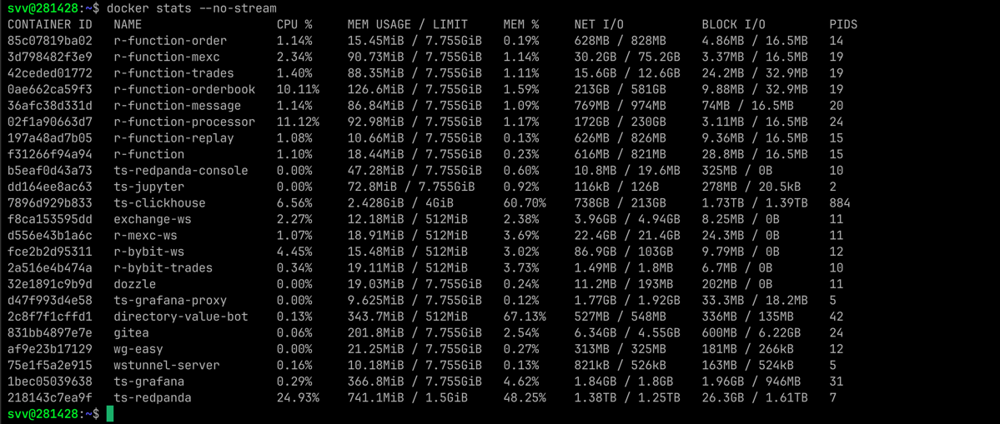

# r-function

*Производственные журналы / Бизнес журнал*

**AI data pipelines для конфигурируемой обработки потоков сообщений с пользовательской логикой 
в WebAssembly-песочнице или с подключением плагинов, c версионированием через Git и детерминированным replay.**
- catalog_setting - описание объектов, которые будут использоваться в пайплайне (Kafka topics)
- consumer_setting - описание консьюмеров, которые будут использоваться в пайплайне
- function_settings - описание атрибутов функций, которые будут использоваться в пайплайне
- function_values - список значений функций, которые будут использоваться в пайплайне
- stream_setting - описание потоков, которые будут использоваться в пайплайне

```value

  "value_key": [
    "topic"
  ],
  "setting_code": "settings_code",
  "key": "key",
  "value": {
    "topic": "topic",
    "code": "code",
    "symbol": "symbol"
  }

```
## Архитектура

```
        ┌──────────────┐     ┌──────────────────────┐     ┌──────────────┐
Kafka → │   Consumer   │ →→  │       Pipeline       │ →→  │   Producer   │ → Kafka
        └──────────────┘     └──────────┬───────────┘     └──────────────┘
                                        │
                                        ▼
                              ┌───────────────────────┐
                              │     Processor         │
                              │  ┌─────────────────┐  │   ┌────────────┐
                              │  │   WasmRuntime   │◄─┼───┤    Git     │
                              │  │   plugin        │  │   │            │
                              │  └─────────────────┘  │   └─────┬──────┘
                              │  ┌─────────────────┐  │         │
                              │  │ function_value  │◄─┼─────────┤  Git stores
                              │  │ (Git, read-only)│  │         │  - catalog_setting     
                              │  └─────────────────┘  │         │  - consumer_setting  
                              │  ┌─────────────────┐  │         │  - function_settings  
                              │  │     Values      │  │         │  - function_values
                              │  │  KV cache (R/W) │  │         │  - stream_setting
                              │  └─────────────────┘  │         │
                              └───────────────────────┘         │
```


# Описание модулей программной системы

**exchange-ws** (Go) — шлюз приёма данных из внешних источников.
Основные функции: подключается к потокам данных внешних систем по WebSocket, нормализует сообщения и добавляет к ним метаданные. Выполняет разовые REST-запросы снимков данных. Запускает и останавливает потоки, управляет их конфигурацией через HTTP API. При обрыве связи переподключается автоматически.
Взаимодействие: публикует данные в Kafka для r-function. Управляется функциями r-function: контроль работоспособности потоков и запрос снимков.

**r-function** (Rust) — сервис потоковой обработки сообщений цепочками функций, которые задаются в настройках.
Основные функции:
- читает топики Kafka и группирует сообщения в пакеты по коду настройки и ключу;
- выполняет функции в изолированной WASM-среде и в нативных плагинах;
- публикует результаты по маршрутам потоков, ошибочные сообщения отправляет в DLQ;
- хранит состояние: оперативный кэш и встроенную базу последних значений и истории;
- применяет изменения настроек и артефактов из Git без перезапуска;
- запускает функции по расписанию;
- предоставляет HTTP/WebSocket API для управления и чтения значений;
- обеспечивает доставку at-least-once с сохранением порядка в партиции;
- поддерживает детерминированный повтор (replay) исторических данных.

Взаимодействие: Kafka (вход и выход), r-json через Gitea, state-service, внешние REST API через посредника на стороне сервиса, сервисы ts-directory. Разворачивается несколькими экземплярами, у каждого своя конфигурация под свой поток данных.

**Функции r-function** (functions/) — прикладная логика обработки.
- WASM-модули: разбор и преобразование входящих потоков, агрегация по временным интервалам, расчёт показателей и сигналов, формирование сообщений, обращение к внешним REST API с авторизацией, контроль работоспособности потоков и подключений.
- Нативные плагины: расчёты с сохранением состояния. Ведут структуры данных, которые собираются из снимков и последовательных обновлений, выполняют оконные статистические расчёты и агрегацию за интервалы.

Взаимодействие: r-function вызывает их через свой программный интерфейс; собранные артефакты публикуются в r-json.

**r-json** (Git-репозиторий) — источник конфигурации и артефактов для r-function.
Содержит JSON-настройки функций, каталогов, маршрутов потоков и потребителей, значения функций по контурам обработки, а также собранные WASM-модули и плагины.
Взаимодействие: размещён в Gitea; r-function периодически синхронизируется с ним.

**state-service** (Python) — восстановление состояния функций.
Основные функции: по REST-запросу рассчитывает состояние функции на заданную дату по истории в ClickHouse. Нужен функциям, которым для работы требуется долго накапливать историю. Работает только на чтение, кэширует ответы.
Взаимодействие: r-function обращается к нему, если ключа нет в памяти.

**ts-directory** (Java, Spring WebFlux):
- **ts-directory-auth** — аутентификация OAuth2 и проверка доступа пользователей; выдача настроек и значений r-function.
- **ts-directory-sse** — потоковая передача клиентам значений и истории через Server-Sent Events, кэш в Redis.
- **ts-directory-import** — импорт значений (JSON, Excel, файлы), выгрузка файлов, сброс кэша.
- **directory-value-bot** — Telegram-бот: доставляет пользователям сообщения из Kafka и передаёт входящие сообщения в Kafka.
- **ts-directory-api, -common, -cache, -function-api, -role-api, -files-api, directory-value-bot-api** — общие библиотеки.

Взаимодействие: получают настройки и значения от r-function по REST, обмениваются данными через Kafka и Redis.

**directory-value-ui** (React) — веб-интерфейс. Показывает графики значений в реальном времени (данные от ts-directory-sse) и загружает файлы для импорта (через ts-directory-import).

**tq-connector** (Java) — коннектор к внешней системе. Подключается к ней, получает справочную информацию и события. Управляется через REST и команды из Kafka.

Используемая инфраструктура: Kafka (Redpanda), ClickHouse, Redis, Gitea с CI, Grafana, Jupyter.

